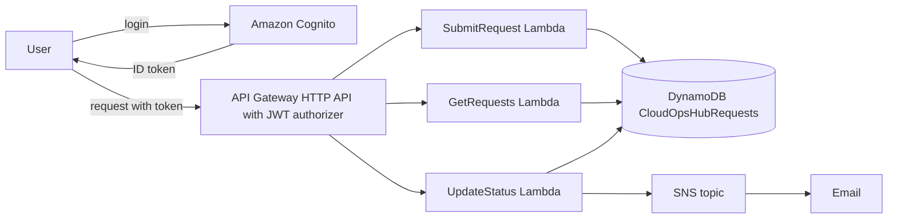

# CloudOpsHub

A serverless change-request platform on AWS. Authenticated users submit requests, an approver approves or rejects them, and email notifications are sent on every status change.

**Status:** backend working and tested. Infrastructure as Code (CloudFormation) is partly done. CI/CD is not done yet.

## Architecture



Region: eu-north-1. Runtime: Node.js 24.

## API

All routes need a Cognito ID token: `Authorization: Bearer <token>`.

| Method | Path | What it does |
|---|---|---|
| POST | /requests | Create a request (status SUBMITTED) |
| GET | /requests | List all requests |
| PATCH | /requests/{requestId} | Set status to APPROVED or REJECTED |

## Workflow

A request starts as SUBMITTED and can move once to APPROVED or REJECTED. Any other change returns HTTP 409.

## Security

- Cognito login with a JWT authorizer on every route. No token returns 401.
- One least-privilege IAM policy per Lambda (for example, SubmitRequest can only PutItem on one table).
- No secrets are stored in this repo.

## What I tested

- No token: 401. Valid token: success.
- Submit a request: 201 with a requestId.
- List requests: 200 with all items.
- Approve and reject: status changes and an email arrives.
- Approve an already approved request: 409.

## Bug I fixed

The submit endpoint failed with a 500 error. CloudWatch logs showed the request body was arriving base64-encoded and JSON.parse failed. The fix was to check `isBase64Encoded` and decode the body first.

## Repository structure

```
src/                    Lambda code (one folder per function)
infrastructure/
  cloudformation/       CloudFormation template
```

## Infrastructure as Code

The DynamoDB table and the SNS topic were imported into a CloudFormation stack. The Lambdas, API Gateway and Cognito are still created in the console and will be moved next.

## Known limitations

- Any signed-in user can approve a request. Roles or groups are not added yet.
- The SNS topic ARN is hard-coded in UpdateStatus. It should be an environment variable.
- GET /requests uses a table scan, which is fine for a small demo only.
- No CloudWatch alarms and no CI/CD pipeline yet.

## Next steps

CloudFormation for the remaining resources, GitHub Actions deployment, CloudWatch alarms, and approver roles.

## Cost note

Everything is pay-per-use serverless. The live AWS resources will be removed when the free tier ends (Feb 2027). The code and templates stay in this repo.
